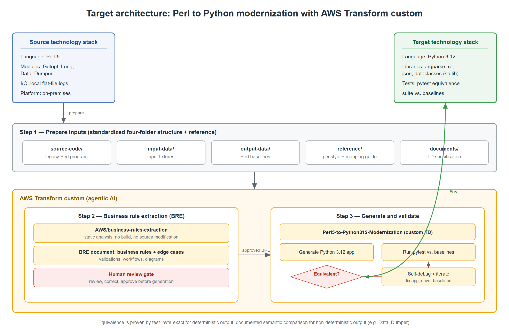

# Perl to Python Modernization with AWS Transform custom

Transform legacy **Perl 5** programs into functionally equivalent, idiomatic
**Python 3.12** applications using [AWS Transform custom](https://docs.aws.amazon.com/transform/latest/userguide/custom.html).

This sample provides a ready-to-use custom transformation definition, a sample
Perl workload with baselines, and an authoritative Perl-to-Python reference
guide. AWS Transform custom analyzes the Perl source, extracts business rules,
generates the Python application, and validates functional equivalence against
the original program's output.

The approach mirrors the AWS Prescriptive Guidance pattern
[Transform Easytrieve to modern languages by using AWS Transform custom](https://docs.aws.amazon.com/prescriptive-guidance/latest/patterns/transform-easytrieve-modern-languages.html),
extended here to a Perl source and a Python target.

---

## Architecture



Legacy Perl is staged in a standardized workload layout (`source-code`,
`input-data`, `output-data`, and a `reference` guide). AWS Transform custom
extracts business rules
(human-reviewed), then generates the Python 3.12 application and validates it
against baselines captured from the original Perl program, iterating until the
behavior matches. Equivalence is proven by test: byte-exact for deterministic
output, and documented semantic comparison for non-deterministic output (such as
`Data::Dumper`).

---

## How it works

A two-stage, human-gated workflow:

```
┌──────────────┐   ┌─────────────────────┐   ┌──────────────────────────┐
│ Prepare      │──▶│ Stage 1: Business   │──▶│ Stage 2: Generate +      │
│ inputs       │   │ Rule Extraction     │   │ validate (Python 3.12)   │
│ (workload +  │   │ (+ human review)    │   │ generate → test → fix    │
│  reference)  │   │                     │   │ until equivalent         │
└──────────────┘   └─────────────────────┘   └──────────────────────────┘
```

1. **Prepare inputs** — a standardized workload layout: `source-code`,
   `input-data`, `output-data`, and a `reference` guide
   (see [Repository structure](#repository-structure)).
2. **Stage 1 — Business Rule Extraction (BRE).** The AWS-managed
   `AWS/business-rules-extraction` transformation statically analyzes the Perl
   source and produces a rewrite-ready specification. A human reviews it before
   generation.
3. **Stage 2 — Generate and validate.** The custom
   `Perl5-to-Python312-Modernization` transformation consumes the reviewed BRE
   and the reference guide, generates the Python app and a pytest suite, runs the
   tests against the baselines, and self-corrects until all in-scope behaviors
   match the original.

---

## Prerequisites

| Requirement | Notes |
|-------------|-------|
| AWS account | with the `AWSTransformCustomFullAccess` managed policy |
| AWS Transform CLI (`atx`) | latest — install: `curl -fsSL https://transform-cli.awsstatic.com/install.sh \| bash` (Windows: `irm https://transform-cli.awsstatic.com/install.ps1 \| iex`) |
| Node.js 22+ | required by the `atx` CLI |
| Git | the working directory must be a Git repository |
| Perl 5 | to capture authoritative baselines from the original program |
| Python 3.12 | target runtime, to run and test the generated app |

> **Platform:** AWS Transform custom runs on Linux, macOS, and native Windows
> (Windows Terminal + PowerShell). On Windows you may also run it under WSL.

Configure and verify credentials:

```bash
aws configure            # region: a supported AWS Transform region, e.g. us-east-1
aws sts get-caller-identity
atx update
atx custom def list --json   # confirms your permissions work
```

---

## Quick start

From the repository root:

The repository is already a Git repo (you cloned it), so no `git init` is
needed — `atx` just requires the working directory to be under Git, which it
already is.

### 1. (Optional) Capture baselines from the original Perl

The sample already ships the baselines under `test/output-data/`. Only
regenerate them if you change the Perl program:

```bash
cd test
perl source-code/log_processor.pl --file input-data/app_traffic.log > output-data/expected_normal.txt
cd ..
```

### 2. Create and publish the transformation definition (one-time)

```bash
atx
# Tell the agent: create a custom transformation named
# Perl5-to-Python312-Modernization using
# documents/transformation_definition.md and
# documents/perl-coding-and-modernization-guide.md as references. Then publish it.
```

The transformation definition is **recreated from the specification**, not
restored from a binary artifact: `documents/transformation_definition.md` is the
human-readable spec, and the `atx` agent builds the published definition from it.
See [`documents/transformation_definition.md`](documents/transformation_definition.md)
for the full specification.

### 3. Stage 1 — extract business rules

```bash
atx custom def exec -n AWS/business-rules-extraction -p ./test -x -t
# Review the generated business-rules-extraction/ directory before continuing.
```

### 4. Stage 2 — generate and validate

```bash
atx custom def exec -n Perl5-to-Python312-Modernization -p ./test -x -t
```

The agent generates `test/python-app/` and iterates until the pytest suite
passes and output matches the baselines.

### 5. Verify independently

```bash
cd test
python3 python-app/log_processor.py --file input-data/app_traffic.log \
  | diff - output-data/expected_normal.txt && echo "EQUIVALENT"
cd python-app && python3 -m pytest -q
```

---

## Repository structure

```
sample-perl-to-python-transform/
├── README.md                              # this file
├── LICENSE                                # MIT-0
├── CONTRIBUTING.md
├── CODE_OF_CONDUCT.md
├── documents/
│   ├── transformation_definition.md       # the custom TD specification
│   └── perl-coding-and-modernization-guide.md  # authoritative Perl→Python reference
└── test/                                  # sample Perl workload (the transform target)
    ├── source-code/
    │   └── log_processor.pl                # legacy Perl program
    ├── input-data/
    │   ├── app_traffic.log                 # normal fixture
    │   └── empty_match.log                 # zero-match fixture
    ├── output-data/                        # authoritative Perl baselines
    │   ├── expected_normal.txt
    │   ├── expected_verbose.txt
    │   ├── expected_dryrun.txt
    │   ├── expected_zero.txt
    │   └── expected_zero_dryrun.txt
    └── reference/                          # reference guide, inside the workload
        └── perl-coding-and-modernization-guide.md
```

> The reference guide lives in two places on purpose: `documents/` is the
> human-readable copy for browsing this repo, and `test/reference/` is the copy
> AWS Transform custom reads during a run (the transformation looks for the guide
> inside the workload it is pointed at). They are identical.

After a run, AWS Transform custom adds `test/business-rules-extraction/` (Stage 1)
and `test/python-app/` (Stage 2, the generated application and tests). Both are
git-ignored so a fresh clone stays input-only.

---

## Validated results

This transformation definition was validated beyond the sample program, with
every run independently verified (byte-for-byte diff against the Perl baseline
plus the generated pytest suite):

| Program | Source | Idioms exercised | Result |
|---------|--------|------------------|--------|
| `log_processor.pl` (this sample) | original | regex capture, records, dry-run | byte-exact, tests pass |
| `transpose` | perl-utils (MIT) | `split` limit, array-of-arrays, output-separator globals | COMPLETE, 27/27 criteria, byte-exact |
| `sponge` | perl-utils (MIT) | stdin soak, `"-"` = STDOUT | byte-exact, tests pass |
| `paragrep` | perl-utils (MIT) | regex paragraph matching, `-i`, `-e` | COMPLETE, byte-exact, tests pass |

Additional offline stress tests covered number/rounding formatting, Perl magic
string increment, default string-vs-numeric sort, `tr///`, and a 20,000-record
volume run — all byte-exact. Equivalence for `Data::Dumper`-style output is
**semantic** (same records and values) rather than byte-exact, because Perl's
hash-dump order is non-deterministic.

> **Note on scope.** This approach targets deterministic, CLI/stdin-driven
> programs. Programs with network calls, databases, concurrency, or real-time
> behavior (e.g. interactive TTY tools) are out of scope for byte-exact
> equivalence and need a different validation strategy.

---

## Troubleshooting

| Symptom | Cause | Fix |
|---------|-------|-----|
| `atx` reports the working directory is not a Git repository | You ran `atx` outside the cloned repo, or in a copied subfolder that lost `.git`. | Run from the repository root (the clone is already a Git repo). If you copied the `test/` folder elsewhere, run `git init` there. |
| The transformation does not find the reference guide | The guide must live **inside** the workload you point `atx` at (`test/reference/`), not only in `documents/`. | Keep `test/reference/perl-coding-and-modernization-guide.md` in place; it is identical to the `documents/` copy. |
| Stage 2 generation is weak or misses rules | Stage 1 (BRE) was skipped or not reviewed. | Always run `AWS/business-rules-extraction` first, review `test/business-rules-extraction/`, then run the custom transformation. The custom definition consumes the reviewed BRE. |
| `atx custom def list` fails with an access error | Missing the `AWSTransformCustomFullAccess` policy, or wrong region. | Attach the policy to your identity and set a supported AWS Transform region (e.g. `us-east-1`). Re-run `aws sts get-caller-identity` to confirm. |
| Generated Python output differs from the baseline on `Data::Dumper` dumps | Perl hash-dump order is non-deterministic. | This is expected — equivalence here is **semantic** (same records and values), not byte-exact. Compare the parsed structure, not the raw text. |
| A run takes much longer than expected | BRE (~15–20 min) and generation (~18 min) are long-running; CLI timeouts may fire before they finish. | Let the run complete and inspect the artifacts afterward rather than relying on the command returning. |
| Byte-exact diff fails on numbers | Perl and Python round/format floats differently. | The reference guide's hardening rules cover this (printf-safe formatting, number-vs-string context); ensure the latest guide is in `test/reference/`. |

---

## Example output

This repository ships **input-only** — the generated `test/python-app/` is not
committed; AWS Transform custom produces it when you run Stage 2 (which is why
the console snippets below are illustrative of a run, not files in a fresh
clone). After a successful Stage 2 run, the generated app lands under
`test/python-app/`. For the sample `log_processor.pl`, the generated
`log_processor.py` is idiomatic Python 3.12. The legacy Perl regex-capture loop
over a bracketed access log — for example
`[2026-10-08 10:15:30] 192.168.1.45 GET /api/v1/users - 200` — becomes a
compiled named-group pattern that maps each line to a record dict:

```python
# generated test/python-app/log_processor.py (illustrative excerpt)
LINE_RE = re.compile(
    r"^\[(?P<ts>[\d\-\s:]+)\]\s+"
    r"(?P<ip>[\d.]+)\s+"
    r"(?P<action>\w+)\s+"
    r"(?P<path>\S+)\s+-\s+"
    r"(?P<code>\d+)$"
)

def parse(path: str, max_rows: int = 5000) -> list[dict]:
    records: list[dict] = []
    with open(path, encoding="utf-8") as fh:
        for line in fh:
            m = LINE_RE.match(line.rstrip("\n"))
            if not m:
                continue
            rec = m.groupdict()
            rec["code"] = int(rec["code"])   # int($status) in the Perl original
            records.append(rec)
            if len(records) >= max_rows:
                break
    return records
```

The exact structure of the generated code varies per run; what the validation
step guarantees is that its **output** matches the Perl baseline. Normal mode
prints a processed-record count:

```console
$ python3 python-app/log_processor.py --file input-data/app_traffic.log \
    | diff - output-data/expected_normal.txt && echo "EQUIVALENT"
EQUIVALENT

$ cat output-data/expected_normal.txt
Successfully processed 7 records from input-data/app_traffic.log.

$ cd python-app && python3 -m pytest -q
.......                                                            [100%]
7 passed in 0.12s
```

Dry-run mode reproduces Perl's `Data::Dumper` layout — including the empty-match
case, where both the Perl original and the generated Python emit an empty
`$VAR1` array:

```console
$ python3 python-app/log_processor.py --file input-data/empty_match.log --dry-run \
    | diff - output-data/expected_zero_dryrun.txt && echo "EQUIVALENT"
EQUIVALENT

$ cat output-data/expected_zero_dryrun.txt
DRY RUN: Schema layout would match:
$VAR1 = [];
```

---

## Best practices

- **Standardized workload layout** — `source-code/`, `input-data/`,
  `output-data/`, and `reference/` (the reference guide travels inside the
  workload so the transformation can read it), validated before transformation.
- **Baseline-driven validation** — capture baselines from the real Perl
  interpreter; byte-exact for deterministic output, documented semantic
  comparison for non-deterministic output.
- **Use authoritative reference material** — the included
  `perl-coding-and-modernization-guide.md` encodes Perl→Python mapping rules,
  including hardening rules (e.g. `split` LIMIT → `maxsplit` is N-1; default
  `sort` is string/ASCII; Perl magic string increment has no Python builtin).
- **Human review gate** before generation — review the BRE and correct gaps.
- **Continual learning** — after each successful run, review and approve the
  knowledge items AWS Transform proposes so later runs improve.
- **Verify independently** — never rely on run status alone; diff the generated
  output against the baseline and run the tests yourself.

---

## Links

- [AWS Transform custom documentation](https://docs.aws.amazon.com/transform/latest/userguide/custom.html)
- [AWS Prescriptive Guidance: Transform Easytrieve to modern languages](https://docs.aws.amazon.com/prescriptive-guidance/latest/patterns/transform-easytrieve-modern-languages.html)
- [AWS Transform pricing](https://aws.amazon.com/transform/pricing/)

---

## Security

See [CONTRIBUTING.md](CONTRIBUTING.md#security-issue-notifications) for how to
report security issues.

## License

This sample is licensed under the MIT-0 License. See [LICENSE](LICENSE).
